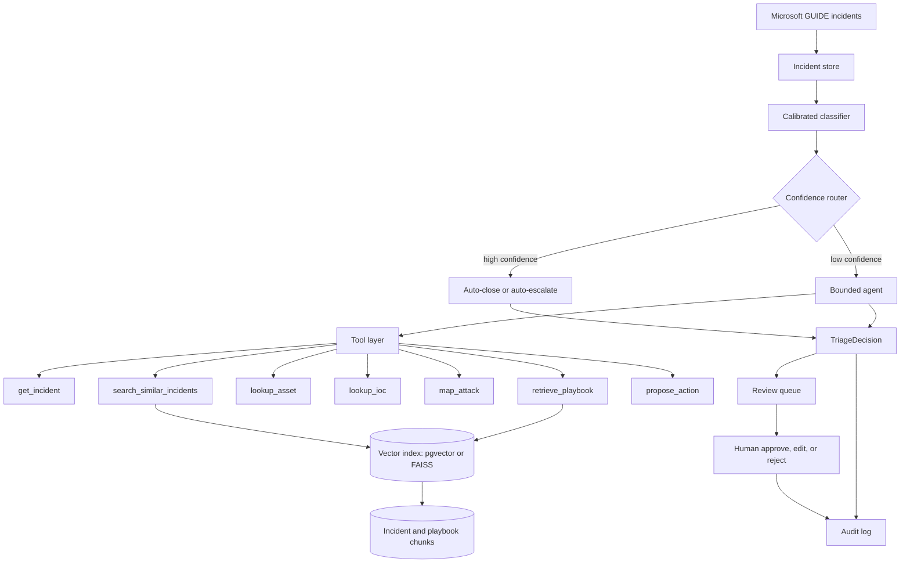

# TriageBudget

A budget-aware RAG and agent system for security incident triage.

**Status: Week 1 pipeline and baselines.** No GUIDE results yet. The pipeline is verified on a synthetic GUIDE-shaped fixture only. Real GUIDE numbers are pending data access.

---

## Skills at a glance

| Skill | How TriageBudget uses it | Proof a reviewer can inspect |
|---|---|---|
| RAG | Retrieves playbooks, incident evidence, and similar past incidents before the agent decides | RAG-only baseline, retrieval report, cited decisions |
| Vector database | Postgres with pgvector in deployment; DuckDB or FAISS locally; `bge-small-en-v1.5` embeddings | Index build script, Recall@k, nDCG@10 |
| Data engineering | GUIDE ingestion, Parquet, DuckDB, split manifests, data-quality checks | `data/` pipeline, `tests/test_data.py` |
| Agents and tool calling | Bounded loop, seven tools, hard six-call cap | Tool traces, structured decisions |
| Evaluation | Selective-risk curve, macro-F1, retrieval metrics, citation accuracy, cost | Frozen test report, risk curve |
| Prompt engineering | Prompt templates, prompt-injection defense, schema constraints | `prompts/` directory, validator tests |
| FastAPI | Incident, decision, approval, and audit endpoints | OpenAPI docs |
| Postgres | Incidents, decisions, reviews, audit events | Schema and SQL queries |
| SQL | DuckDB and Postgres queries for features, metrics, and audit slices | `sql/` directory, analytical queries |
| Structured outputs | Pydantic `TriageDecision`, schema validation, repair or abstain | Schema tests and validator |
| Human-in-the-loop | Reviewer queue with approve, edit, reject, and audit log | Approval flow and audit events |
| Classical ML | TF-IDF plus LightGBM with calibration | Model card, calibration plot |
| PyTorch (optional) | MiniLM or cross-encoder fine-tune | Training script, ablation |
| Testing | pytest unit, data-integrity, and API tests | `tests/`, CI test run |
| Docker | Local stack and deployment | `Dockerfile`, `docker-compose.yml` |
| CI/CD | Tests and evaluation gate on every push | GitHub Actions workflow |
| Cloud deployment | Render free web service, Neon Postgres, Cloudflare Pages | Live URL and deploy config |
| Git and GitHub | Public repo, small commits, issues, pull requests | Commit history and PRs |
| Observability | Langfuse or structured JSON logs | Trace and cost table |
| Security | Redaction, injection defense, no autonomous action | Threat model, audit log |

---

## Problem

Security operations centers do not lack alerts. They lack analyst minutes.

- 73% of SOC teams cite false positives as a top detection-and-response challenge, up from 64% the previous year (SANS 2025).
- About half of alerts go uninvestigated (SANS 2026).
- The security workforce gap is roughly 4.8 million people (ISC2 / SANS).
- A worked example of 4,500 alerts per day needs about 94 full-time analysts at 10 minutes per alert (SANS 2026).

Most AI SOC products answer "can a model triage this alert?" The more useful question is: **at a fixed analyst budget, how many incidents can be closed safely, and what is the miss rate when we do?**

TriageBudget is built around that question.

---

## What it does

1. **Loads incidents.** Ingests Microsoft GUIDE incident records: alerts, evidence, entities, labels, and analyst priority.
2. **Classifies.** A calibrated TF-IDF + LightGBM baseline scores each incident for true positive, benign positive, and false positive.
3. **Routes by confidence.** High-confidence incidents are auto-closed or auto-escalated. Low-confidence incidents go to a bounded agent.
4. **Investigates with RAG.** The agent retrieves evidence, finds similar incidents, maps ATT&CK techniques, and checks asset and IOC context. It has a hard tool-call budget.
5. **Produces a decision packet.** Every verdict includes a priority, proposed remediation, cited evidence, confidence, and a `needs_human` flag.
6. **Hands off to a queue.** A reviewer approves, edits, or rejects. Every action is written to an audit log.

The LLM never computes the numbers. The classifier, tools, and policy layer do. The LLM explains and selects tools.

---

## Why this is different

| Common SOC demo | TriageBudget |
|---|---|
| "Chat with your alerts" | A triage queue with structured decisions |
| Accuracy on a toy set | Selective-risk curve on external GUIDE labels |
| Agent runs on every alert | Agent runs only on routed low-confidence incidents |
| Model reports its own confidence | Calibration is measured against analyst labels |
| No cost model | Cost per 1,000 incidents and p95 latency are reported |
| No audit trail | Every decision has citations and an append-only log |
| One aggregate score | Per-class, per-organization, and per-budget slices |

The headline artifact is not a chatbot. It is a **selective-risk curve**: coverage (share of incidents handled without human review) against miss rate (share of true positives that were auto-closed incorrectly), with cost and latency attached.

---

## What you can inspect

Week 1 artifacts:

- `src/triage/`: GUIDE ETL, frozen split manifest, baselines, and integrity checks.
- `tests/`: fixture-backed data and baseline tests.
- `reports/fixture_run/`: fixture-only report and metrics. These are not GUIDE results.
- `.github/workflows/ci.yml`: lint, tests, and fixture smoke run.

Later weeks add:

- `reports/final_eval.md`: headline metrics, split details, and confidence intervals.
- `reports/risk_coverage.png`: the selective-risk curve with the 10-minute operating point.
- `reports/retrieval.md`: Recall@5, Recall@10, nDCG@10, and the reranker ablation.
- `reports/citations.md`: citation support rate, disagreement examples, and the human rubric.
- `/docs`: OpenAPI documentation served by FastAPI.
- `audit/`: append-only reviewer actions.
- GitHub Actions run: tests, data checks, and the smoke evaluation gate.

No GUIDE benchmark artifacts exist yet.

---

## Architecture: RAG, classifier, and agent



The agent is optional by design. If the classifier is confident, the system does not pay for an LLM call. If the agent is unavailable or over budget, the incident falls back to the human queue.

### RAG and retrieval

RAG is not a separate chatbot. It is the evidence layer the agent uses before it writes a decision.

- `search_similar_incidents` retrieves past incidents with known labels.
- `retrieve_playbook` retrieves remediation steps and policy passages.
- Evidence retrieval pulls the specific alerts, entities, and log lines that support or weaken a verdict.
- The agent reranks the candidates, cites the evidence ids it used, and abstains when the retrieved evidence does not support a decision.

Retrieval is hybrid: BM25 plus dense vectors, with an optional cross-encoder reranker. The evaluation compares BM25-only, dense-only, and hybrid retrieval, and includes a no-retrieval ablation.

### Vector database

Embeddings are generated locally with `bge-small-en-v1.5` (384 dimensions). Local experiments use DuckDB or FAISS. The deployed demo uses Postgres with pgvector on Neon.

The index stores incident summaries, evidence chunks, and playbook sections. The test split is never added to the index. A retrieval run reports Recall@5, Recall@10, nDCG@10, and mean reciprocal rank.

See [docs/architecture.md](docs/architecture.md) for components, data contracts, and failure handling.

---

## Evaluation

All metrics are planned. None have been measured yet.

| Metric | What it measures | Baseline |
|---|---|---|
| Macro-F1 | Three-class triage quality | Majority class, rules, TF-IDF + LightGBM |
| Per-class precision / recall | True positive, benign positive, false positive | Same |
| P@5 / P@10 / P@20 | Priority ranking quality | Analyst priority, random |
| Remediation macro-F1 | Recommended action quality | Majority action |
| Retrieval Recall@5 / Recall@10 | Did the right evidence or playbook appear in the top results? | BM25-only, dense-only, hybrid |
| nDCG@10 | Ranking quality of retrieved evidence | BM25-only, dense-only, hybrid |
| Selective risk at 10-minute budget | Coverage vs miss rate | Zero-shot LLM, RAG-only, full agent |
| Citation accuracy | Does the cited evidence support the decision? | Human spot check |
| Cost per 1,000 incidents | Token and compute cost | Full-agent baseline |
| p95 latency | Warm and cold start | Same |

Target claim, to be tested: at a 10-minute analyst review budget, auto-close at least 60% of incidents while missing no more than 1% of true positives. If the data does not support that claim, the report will say so.

See [docs/evaluation.md](docs/evaluation.md) for metric definitions, splits, ablations, and the falsification plan.

---

## Data

| Item | Value |
|---|---|
| Dataset | Microsoft GUIDE |
| Incidents | 1,000,000 |
| Evidence items | 13,000,000 |
| Alerts | 1,600,000 |
| Triage labels | True positive, benign positive, false positive |
| Remediation labels | 26,000 |
| Expert-ranked incidents | 9,980 across 499 organization queues |
| License | CDLA-Permissive-2.0 |
| Size | About 3.5 GB |
| Source | [Kaggle](https://www.kaggle.com/datasets/Microsoft/microsoft-security-incident-prediction) |
| Paper | [arXiv:2407.09017](https://arxiv.org/abs/2407.09017) |

The dataset has an official incident-level train/test split. TriageBudget will use it where available. If the Kaggle test labels are hidden, the project will use a frozen local held-out split and label it as such. It will not claim official test numbers.

See [docs/data.md](docs/data.md) for schema, sampling, quality checks, and PII handling.

---

## Commands

Week 1 commands:

```bash
uv sync --all-groups
uv run pytest
uv run ruff check .
uv run python -m triage.cli fixture-eval --work-dir reports/fixture_run
```

The fixture run writes a report and metrics under `reports/fixture_run/`. It is a smoke test, not a GUIDE benchmark.

Real GUIDE run, after placing `GUIDE_Train.csv` and `GUIDE_Test.csv` in `data/raw/`:

```bash
uv run python -m triage.cli etl --raw-dir data/raw --out data/processed/incidents.parquet --stats data/processed/etl_stats.json
uv run python -m triage.cli split --incidents data/processed/incidents.parquet --out-dir data/processed --manifest data/manifests/split_v1.json --sample-size 100000
uv run python -m triage.cli baselines --train data/processed/train.parquet --dev data/processed/dev.parquet --test data/processed/test.parquet --manifest data/manifests/split_v1.json --report reports/w1_baselines.md --metrics reports/w1_metrics.json --dataset guide
uv run python -m triage.cli check --incidents data/processed/incidents.parquet --manifest data/manifests/split_v1.json
```

The `Makefile` mirrors these commands for Unix and CI. `make` is not installed on the current Windows machine, so the CLI commands above are canonical.

Every evaluation writes machine-readable results and a human-readable report. A clean clone with a Kaggle token should reproduce the same numbers.

---

## Repository layout

```text
src/triage/
  config.py      constants and column contracts
  data.py        GUIDE ETL, manifest, integrity checks
  baselines.py   majority, rules, TF-IDF + LightGBM, metrics
  fixture.py     synthetic GUIDE-shaped CSVs
  pipeline.py    end-to-end fixture run
  cli.py         command line entry point
tests/           data and baseline tests
docs/            architecture, data, evaluation, roadmap
reports/         generated reports and metrics
```

---

## Six-week plan

| Week | Focus | Artifact |
|---|---|---|
| 0 | Load 10k incidents, profile labels, LightGBM baseline | First macro-F1 table |
| 1 | Full data pipeline, split manifest, majority and rules baselines | Reproducible baseline report |
| 2 | Calibrated classifier, per-class metrics, optional MiniLM or cross-encoder fine-tune | Calibration and per-class table |
| 3 | RAG index, hybrid retrieval, agent tools, structured output, trace logging | Agent demo on 20 incidents |
| 4 | Confidence router, selective-risk curve, retrieval ablations, error taxonomy | Headline curve and ablation table |
| 5 | FastAPI, queue UI, audit log, Docker, Render/Neon, CI | Live URL and API docs |
| 6 | Frozen test, bootstrap intervals, per-organization slices, README, demo video | Final report and demo |

Cut list, in order: 1M to 100k incidents, 499 to 50 queues, agent subset 2,000 to 500, skip the fine-tune, React to Streamlit, live URL to Docker Compose plus a recorded demo. The external labels, selective-risk curve, citations, and audit log stay.

See [docs/roadmap.md](docs/roadmap.md) for gates and the risk register.

---

## Skills in depth

- RAG over incident evidence, playbooks, and similar past incidents, with hybrid retrieval and citations.
- Vector search with pgvector and `bge-small-en-v1.5`, evaluated with Recall@5, Recall@10, and nDCG@10.
- Data engineering with GUIDE ingestion, Parquet, DuckDB, split manifests, and data-quality tests.
- Bounded agent tool use with a hard call budget and full tool traces.
- External evaluation with real analyst labels, calibration, and selective prediction.
- Prompt engineering with versioned templates, prompt-injection defense, and schema-constrained output.
- Classical ML baseline with TF-IDF, LightGBM, and probability calibration.
- Optional PyTorch fine-tune for a MiniLM or cross-encoder reranker.
- FastAPI and Postgres for the API, decisions, reviews, and audit events.
- SQL with DuckDB and Postgres for features, evaluation slices, and audit queries.
- Structured outputs with Pydantic schemas, validation, repair, and abstention.
- Testing with pytest unit tests, data-integrity checks, and API integration tests.
- Human-in-the-loop review with approve, edit, reject, and an append-only audit log.
- Docker for a reproducible local stack.
- Cloud deployment on Render, Neon, and Cloudflare Pages free tiers.
- CI with tests, data checks, and an evaluation regression gate.
- Git and GitHub with a public repo, small commits, and pull requests.
- Observability with Langfuse or structured JSON logs.
- Security-minded design: redaction, no autonomous action, citations, audit log, and PII handling.

---

## Limitations

- This is a research prototype, not a production SOC tool.
- GUIDE comes from Microsoft customer environments. Performance may not transfer to other telemetry.
- The classifier can run on the full test set. The agent will run on a stratified subset because free LLM tiers are rate-limited.
- Human approval is required for closures and escalations. The system does not take autonomous action.
- This project is not affiliated with Microsoft.
- No benchmark numbers are claimed until the evaluation is run.

---

## Documentation

- [Architecture](docs/architecture.md)
- [Evaluation](docs/evaluation.md)
- [Data](docs/data.md)
- [Roadmap](docs/roadmap.md)
- [B2B data feasibility research](b2b-ai-data-feasibility.md)

---

## License

Code: MIT. Data: Microsoft GUIDE under CDLA-Permissive-2.0. See the dataset card before redistributing.
