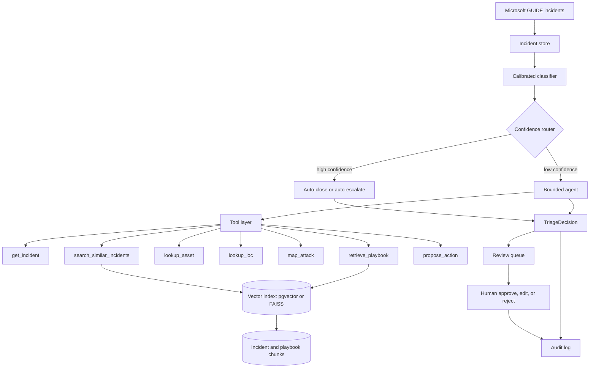

# TriageBudget

A budget-aware RAG and agent system for security incident triage.

**Status: Week 3 retrieval and bounded agent are in.** Hybrid BM25 + dense retrieval over 14,664 deduplicated train incidents and 63 synthetic playbook sections returns a relevant incident or playbook citation in 19/20 smoke queries. The test split is not indexed. A bounded offline agent produces schema-valid decisions on 20 hand-picked exception cases: 20/20 valid, 0 hard-constraint violations, 5.00 mean tool calls. It flags human review on all three missed true positives and auto-closes nothing. The Week 2 calibrated classifier remains the scoring layer: macro-F1 0.7199 before calibration and 0.7282 after vector scaling, ECE 0.0184 to 0.0051. True-positive recall falls from 0.684 to 0.516, so the router must use calibrated `p_true_positive`. The clean-clone reproduction check remains open.

---

## Skills at a glance

Rows marked **planned** are not built yet. Week 1 to Week 3 rows have runnable artifacts.

| Skill | How TriageBudget uses it | Proof a reviewer can inspect |
|---|---|---|
| RAG | Retrieves similar train incidents and playbook sections before a decision; hybrid BM25 + dense + reciprocal rank fusion | `reports/w3_retrieval.md`, 19/20 smoke citations |
| Vector database | Exact numpy inner product over 384-d `bge-small-en-v1.5` vectors locally; pgvector planned for the deployed demo | Index manifest, leakage check, Recall@k |
| Data engineering | GUIDE ingestion, Parquet, DuckDB, split manifests, data-quality checks | `data/` pipeline, `tests/test_data.py` |
| Agents and tool calling | Bounded offline policy over seven typed tools with a hard six-call cap | `reports/w3_agent.md`, tool traces |
| Evaluation | Macro-F1, calibration, retrieval Recall@k and nDCG, schema validity, tool budget | Week 1 to Week 3 reports |
| Prompt engineering | Versioned prompt templates, injection rules, schema constraints; not executed by an LLM in Week 3 | `prompts/`, validator tests |
| FastAPI (**planned**) | Incident, decision, approval, and audit endpoints | Not built yet |
| Postgres (**planned**) | Incidents, decisions, reviews, audit events | Not built yet |
| SQL | DuckDB queries for features, metrics, and evaluation slices; Postgres planned | `src/triage/data.py`, `tests/test_data.py` |
| Structured outputs | Dataclass `TriageDecision`, schema validation, repair or abstain | `tests/test_agent.py` |
| Human-in-the-loop (**planned**) | Reviewer queue with approve, edit, reject, and audit log | Not built yet |
| Classical ML | TF-IDF plus LightGBM with calibration | Model card, reliability diagram |
| PyTorch (**planned**) | MiniLM or cross-encoder fine-tune | Not built yet |
| Testing | pytest unit and data-integrity tests | `tests/`, CI test run |
| Docker (**planned**) | Local stack and deployment | Not built yet |
| CI/CD | Tests and fixture evaluation on every push | GitHub Actions workflow |
| Cloud deployment (**planned**) | Render free web service, Neon Postgres, Cloudflare Pages | Not built yet |
| Git and GitHub | Public repo, small commits, issues, pull requests | Commit history and PRs |
| Observability | Structured JSON traces with tool latency and prompt hashes; Langfuse planned | `reports/w3_traces.json` |
| Security | Redaction, injection defense, no autonomous action | Validator tests, trace redaction |

---

## Problem

Security operations centers do not lack alerts. They lack analyst minutes.

- 73% of SOC teams cite false positives as a top detection-and-response challenge, up from 64% the previous year (SANS 2025).
- About half of alerts go uninvestigated (SANS 2026).
- The security workforce gap is roughly 4.8 million people (ISC2 / SANS).
- A worked example of 4,500 alerts per day needs about 94 full-time analysts at 10 minutes per alert (SANS 2026).

Most AI SOC products answer "can a model triage this alert?" The more useful question is: **at a fixed analyst budget, how many incidents can be closed safely, and what is the miss rate when we do?**

TriageBudget is built around that question.

---

## What it does

1. **Loads incidents.** Ingests Microsoft GUIDE incident records: alerts, evidence, entities, labels, and organization queue metadata.
2. **Classifies.** A calibrated TF-IDF + LightGBM baseline scores each incident for true positive, benign positive, and false positive.
3. **Routes by confidence.** The calibrated classifier scores each incident. The selective-risk router that turns those scores into auto-close and auto-escalate thresholds is Week 4. Week 3 exercises a conservative policy on exception cases and auto-closes none.
4. **Investigates with RAG.** The bounded agent retrieves similar incidents and playbook sections, maps ATT&CK techniques, and proposes remediation. It has a hard six-call budget and logs every tool call.
5. **Produces a decision packet.** Every verdict includes a priority, proposed remediation, cited evidence, confidence, and a `needs_human` flag.
6. **Hands off to a queue.** The reviewer queue and audit log are planned for Week 5. Week 3 writes a trace for every decision.

The deterministic policy and tools produce the numbers and the decision in Week 3. The prompt templates exist, but no external LLM is called yet.

---

## Why this is different

| Common SOC demo | TriageBudget |
|---|---|
| "Chat with your alerts" | A triage queue with structured decisions |
| Accuracy on a toy set | Selective-risk curve on external GUIDE labels |
| Agent runs on every alert | Agent runs only on routed low-confidence incidents |
| Model reports its own confidence | Calibration is measured against analyst labels |
| No cost model | Cost per 1,000 incidents and p95 latency are reported |
| No audit trail | Every decision has citations and an append-only log |
| One aggregate score | Per-class, per-organization, and per-budget slices |

The headline artifact is not a chatbot. It is a **selective-risk curve**: coverage (share of incidents handled without human review) against miss rate (share of true positives that were auto-closed incorrectly), with cost and latency attached.

---

## What you can inspect

Week 1 to Week 3 artifacts:

- `src/triage/`: GUIDE ETL, frozen split manifest, baselines, calibrated classifier, retrieval index, bounded agent, and integrity checks.
- `tests/`: fixture-backed data, baseline, classifier, retrieval, and agent tests.
- `reports/w1_baselines.md` and `reports/w1_metrics.json`: real GUIDE baseline report and machine-readable metrics.
- `reports/w2_classifier.md`, `reports/w2_metrics.json`, and `reports/w2_reliability.svg`: real GUIDE calibration report, metrics, and reliability diagram.
- `reports/w3_retrieval.md` and `reports/w3_retrieval_metrics.json`: hybrid retrieval metrics, index size, latency, and leakage check.
- `reports/w3_agent.md`, `reports/w3_agent_metrics.json`, and `reports/w3_traces.json`: 20 exception-case decisions, schema validity, tool calls, and per-case traces.
- `models/classifier_v1/`: trained model, vectorizer, calibrator, metadata, and model card.
- `indexes/w3_retrieval/`: local index, document store, and manifest. Gitignored because it holds GUIDE-derived text.
- `data/playbooks/`: nine synthetic playbooks with 63 sections, explicitly labelled synthetic.
- `data/cases/w3_cases.json`: 20 hand-picked dev cases and expected labels. Labels are used for evaluation only.
- `prompts/`: versioned system and decision templates. Week 3 does not call an external LLM.
- `data/manifests/split_v1.json`: frozen split manifest with source and split hashes.
- `reports/fixture_run/`: fixture-only smoke report. Not a GUIDE result.
- `.github/workflows/ci.yml`: lint, tests, and fixture smoke run.

Later weeks add:

- `reports/final_eval.md`: headline metrics, split details, and confidence intervals.
- `reports/risk_coverage.png`: the selective-risk curve with the 10-minute operating point.
- `reports/citations.md`: human citation support rate, disagreement examples, and the rubric.
- `/docs`: OpenAPI documentation served by FastAPI.
- `audit/`: append-only reviewer actions.
- GitHub Actions run: tests, data checks, and the smoke evaluation gate.

Week 1 to Week 3 GUIDE artifacts are real: the frozen split manifest, baseline report, calibrated classifier report, retrieval metrics, agent traces, and reliability diagram. Later-week artifacts do not exist yet.

---

## Architecture: RAG, classifier, and agent



The agent is optional by design. If the classifier is confident, the system does not pay for an LLM call. If the agent is unavailable or over budget, the incident falls back to the human queue.

### RAG and retrieval

RAG is not a separate chatbot. It is the evidence layer the agent uses before it writes a decision.

- `search_similar_incidents` retrieves past train incidents with known labels.
- `retrieve_playbook` retrieves synthetic remediation and triage sections.
- The public GUIDE release has evidence ids but not raw evidence text. Week 3 cites the derived incident summary, the nearest train precedent, and the top playbook section. It cannot cite a raw log line.
- The agent uses the retrieved material in a deterministic policy, cites the evidence ids it used, and abstains when the calibrated score is weak.

Retrieval is hybrid: BM25 plus dense vectors fused with reciprocal rank fusion. A cross-encoder reranker is planned but not measured. The evaluation compares BM25-only, dense-only, and hybrid retrieval.

### Vector database

Embeddings are generated locally with `bge-small-en-v1.5` (384 dimensions). Week 3 uses an exact numpy inner-product index over 14,727 documents. The deployed pgvector index is planned for Week 5.

The index stores deduplicated incident summaries and playbook sections. It does not store raw evidence text. The test split is never added to the index; the build fails if an indexed train incident id appears in test. A retrieval run reports Recall@5, Recall@10, nDCG@10, mean reciprocal rank, index size, and latency.

See [docs/architecture.md](docs/architecture.md) for components, data contracts, and failure handling.

---

## Evaluation

Week 1 to Week 3 metrics are measured. Cost, selective risk, citation support, and remediation quality are planned.

Week 3 retrieval, hybrid BM25 + dense + RRF, 100 dev proxy queries:

| Metric | Incident retrieval | Playbook retrieval |
|---|---:|---:|
| Recall@5 | 0.4267 | 0.4217 |
| Recall@10 | 0.6733 | 0.6750 |
| nDCG@10 | 0.5013 | n/a |
| MRR | 0.5747 | n/a |
| median latency | 41.3 ms | 41.3 ms |

The gold sets are structured-overlap proxies, not human relevance labels. Smoke citations are 19/20. The index has 0 test incident overlap. Agent results: 20/20 schema-valid, 0 hard-constraint violations, 5.00 mean tool calls, 7/7 true positives with a retrieval citation, and 3/3 missed true positives flagged for human review.

| Metric | What it measures | Baseline |
|---|---|---|
| Macro-F1 | Three-class triage quality | Majority class, rules, TF-IDF + LightGBM |
| Per-class precision / recall | True positive, benign positive, false positive | Same |
| Queue ranking proxy P@5 / P@10 / P@20 | True-positive ranking within organization queues | Signal-only score |
| Remediation macro-F1 | Recommended action quality | Majority action |
| Retrieval Recall@5 / Recall@10 | Did the right evidence or playbook appear in the top results? | BM25-only, dense-only, hybrid |
| nDCG@10 | Ranking quality of retrieved evidence | BM25-only, dense-only, hybrid |
| Selective risk at 10-minute budget | Coverage vs miss rate | Zero-shot LLM, RAG-only, full agent |
| Citation accuracy | Does the cited evidence support the decision? | Human spot check |
| Cost per 1,000 incidents | Token and compute cost | Full-agent baseline |
| p95 latency | Warm and cold start | Same |

Target claim, to be tested: at a 10-minute analyst review budget, auto-close at least 60% of incidents while missing no more than 1% of true positives. If the data does not support that claim, the report will say so.

See [docs/evaluation.md](docs/evaluation.md) for metric definitions, splits, ablations, and the falsification plan.

---

## Data

| Item | Value |
|---|---|
| Dataset | Microsoft GUIDE |
| Incidents | 1,000,000 |
| Evidence items | 13,000,000 |
| Alerts | 1,600,000 |
| Triage labels | True positive, benign positive, false positive |
| Remediation labels | 26,000 |
| Queue-ranked test incidents (public CSV) | 9,980 across 499 organization queues |
| License | CDLA-Permissive-2.0 |
| Size | About 3.5 GB |
| Source | [Kaggle](https://www.kaggle.com/datasets/Microsoft/microsoft-security-incident-prediction) |
| Paper | [arXiv:2407.09017](https://arxiv.org/abs/2407.09017) |

The dataset has an official incident-level train/test split. TriageBudget will use it where available. If the Kaggle test labels are hidden, the project will use a frozen local held-out split and label it as such. It will not claim official test numbers.

See [docs/data.md](docs/data.md) for schema, sampling, quality checks, and PII handling.

---

## Commands

Week 1 to Week 3 commands:

```bash
uv sync --all-groups
uv run pytest
uv run ruff check .
uv run python -m triage.cli fixture-eval --work-dir reports/fixture_run
```

The fixture run writes a report and metrics under `reports/fixture_run/`. It is a smoke test, not a GUIDE benchmark.

Real GUIDE run, after placing `GUIDE_Train.csv` and `GUIDE_Test.csv` in `data/raw/`:

```bash
uv run python -m triage.cli etl --raw-dir data/raw --out data/processed/incidents.parquet --stats data/processed/etl_stats.json
uv run python -m triage.cli split --incidents data/processed/incidents.parquet --out-dir data/processed --manifest data/manifests/split_v1.json --sample-size 100000
uv run python -m triage.cli baselines --train data/processed/train.parquet --dev data/processed/dev.parquet --test data/processed/test.parquet --manifest data/manifests/split_v1.json --report reports/w1_baselines.md --metrics reports/w1_metrics.json --dataset guide
uv run python -m triage.cli classify --train data/processed/train.parquet --dev data/processed/dev.parquet --test data/processed/test.parquet --manifest data/manifests/split_v1.json --report reports/w2_classifier.md --metrics reports/w2_metrics.json --model-dir models/classifier_v1 --dataset guide
uv run python -m triage.cli check --incidents data/processed/incidents.parquet --manifest data/manifests/split_v1.json
uv run python -m triage.retrieval build --train data/processed/train.parquet --dev data/processed/dev.parquet --test data/processed/test.parquet --playbooks data/playbooks --out indexes/w3_retrieval --report reports/w3_retrieval.md --metrics reports/w3_retrieval_metrics.json --dataset guide
uv run python -m triage.agent --case case_01
uv run python -m triage.agent
```

The `Makefile` mirrors these commands for Unix and CI. `make` is not installed on the current Windows machine, so the CLI commands above are canonical. The first retrieval build downloads `bge-small-en-v1.5` and embeds the train corpus; later runs reuse the local index.

Every evaluation writes machine-readable results and a human-readable report. A clean clone with a Kaggle token should reproduce the same numbers.

---

## Repository layout

```text
src/triage/
  config.py      constants and column contracts
  data.py        GUIDE ETL, manifest, integrity checks
  baselines.py   majority, rules, TF-IDF + LightGBM, metrics
  classifier.py  tuned calibrated classifier, reliability, queue ranking
  retrieval.py   incident/playbook corpus, BM25, dense index, hybrid search
  agent.py       typed tools, TriageDecision, bounded offline policy, traces
  fixture.py     synthetic GUIDE-shaped CSVs
  pipeline.py    end-to-end fixture run
  cli.py         command line entry point
tests/           data, classifier, retrieval, and agent tests
docs/            architecture, data, evaluation, roadmap
reports/         generated reports, metrics, and traces
prompts/         versioned agent prompt templates
data/playbooks/  nine synthetic playbooks, 63 sections
data/cases/      20 hand-picked Week 3 exception cases
indexes/         local retrieval index (gitignored)
```

---

## Six-week plan

| Week | Focus | Artifact |
|---|---|---|
| 0 | Load 10k incidents, profile labels, LightGBM baseline | First macro-F1 table |
| 1 | Full data pipeline, split manifest, majority and rules baselines | Reproducible baseline report |
| 2 | Calibrated classifier, per-class metrics, optional MiniLM or cross-encoder fine-tune | Calibration and per-class table |
| 3 | RAG index, hybrid retrieval, agent tools, structured output, trace logging | Agent demo on 20 incidents |
| 4 | Confidence router, selective-risk curve, retrieval ablations, error taxonomy | Headline curve and ablation table |
| 5 | FastAPI, queue UI, audit log, Docker, Render/Neon, CI | Live URL and API docs |
| 6 | Frozen test, bootstrap intervals, per-organization slices, README, demo video | Final report and demo |

Cut list, in order: 1M to 100k incidents, 499 to 50 queues, agent subset 2,000 to 500, skip the fine-tune, React to Streamlit, live URL to Docker Compose plus a recorded demo. The external labels, selective-risk curve, citations, and audit log stay.

See [docs/roadmap.md](docs/roadmap.md) for gates and the risk register.

---

## Skills in depth

- RAG over incident evidence, playbooks, and similar past incidents, with hybrid retrieval and citations.
- Vector search with pgvector and `bge-small-en-v1.5`, evaluated with Recall@5, Recall@10, and nDCG@10.
- Data engineering with GUIDE ingestion, Parquet, DuckDB, split manifests, and data-quality tests.
- Bounded agent tool use with a hard call budget and full tool traces.
- External evaluation with real analyst labels, calibration, and selective prediction.
- Prompt engineering with versioned templates, prompt-injection defense, and schema-constrained output.
- Classical ML baseline with TF-IDF, LightGBM, and probability calibration.
- Optional PyTorch fine-tune for a MiniLM or cross-encoder reranker.
- FastAPI and Postgres for the API, decisions, reviews, and audit events.
- SQL with DuckDB and Postgres for features, evaluation slices, and audit queries.
- Structured outputs with Pydantic schemas, validation, repair, and abstention.
- Testing with pytest unit tests, data-integrity checks, and API integration tests.
- Human-in-the-loop review with approve, edit, reject, and an append-only audit log.
- Docker for a reproducible local stack.
- Cloud deployment on Render, Neon, and Cloudflare Pages free tiers.
- CI with tests, data checks, and an evaluation regression gate.
- Git and GitHub with a public repo, small commits, and pull requests.
- Observability with Langfuse or structured JSON logs.
- Security-minded design: redaction, no autonomous action, citations, audit log, and PII handling.

---

## Limitations

- This is a research prototype, not a production SOC tool.
- GUIDE comes from Microsoft customer environments. Performance may not transfer to other telemetry.
- The classifier can run on the full test set. The agent will run on a stratified subset because free LLM tiers are rate-limited.
- Human approval is required for closures and escalations. The system does not take autonomous action.
- This project is not affiliated with Microsoft.
- Benchmark numbers come from one frozen GUIDE split. They are not production estimates.
- Organization identity and organization frequency are excluded from the headline classifier because queue-specific labeling styles leak into the score. The org-frequency ablation is reported, not used.
- The public GUIDE release includes queue ranks for 9,980 test incidents but no severity column. The Week 2 queue ranking result is a true-positive proxy; Week 4 will evaluate analyst P@5/10/20 against `QueueRank`.
- Calibration improves macro-F1 but lowers true-positive recall from 0.684 to 0.516. The router must use calibrated `p_true_positive` and a selective-risk curve.
- Hyperparameter tuning and calibrator selection both use the same dev rows. The test split is untouched, but the calibrator choice is optimistic; nested cross-validation or a separate calibration split is future work.
- Week 3 retrieval gold sets are structured-overlap proxies. They are not human relevance labels, so the retrieval numbers measure a reproducible proxy, not analyst-judged quality.
- Playbooks are synthetic and do not represent an organization's real policy. Raw GUIDE evidence text is unavailable, so citations use derived summaries and ids, not log lines.
- The Week 3 agent is an offline deterministic policy, not an LLM. Prompt templates exist but were not executed. Exact label agreement on the 20 hand-picked cases is 0.75; that number is descriptive, not a benchmark.
- The agent missed 3 of 7 true-positive cases and flagged all three for human review. It auto-closed none of the 20 exception cases. One miss, `36:1064`, is a 0.937 false-positive prediction with no malicious verdict; suspicious signals and a true-positive precedent kept it out of auto-close. Router safety and coverage are Week 4 work.
- No cross-encoder reranker is measured. The local index is exact numpy search, not pgvector.
- Alert IDs overlap between raw train and test: 15,301 test incidents (5.0%) share at least one alert with the frozen train sample. Incident-level disjointness holds; an alert-disjoint sensitivity run is still pending.

---

## Documentation

- [Architecture](docs/architecture.md)
- [Evaluation](docs/evaluation.md)
- [Data](docs/data.md)
- [Roadmap](docs/roadmap.md)
- [B2B data feasibility research](b2b-ai-data-feasibility.md)

---

## License

Code: MIT. Data: Microsoft GUIDE under CDLA-Permissive-2.0. See the dataset card before redistributing.
