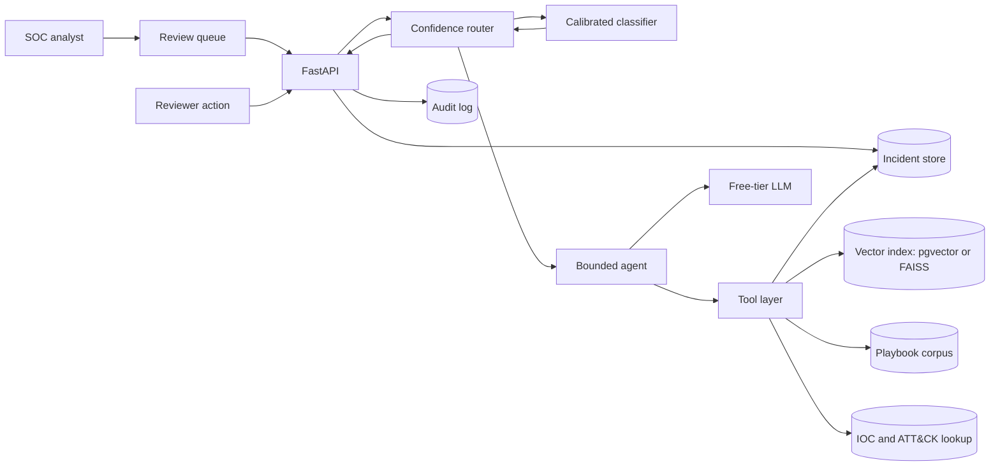
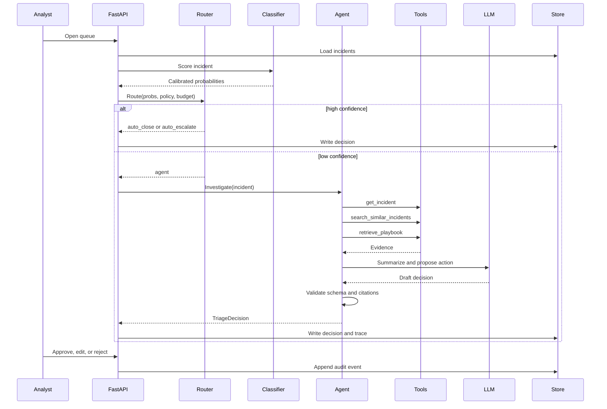

# Architecture

TriageBudget is a budget-aware triage system for security incidents. This document describes the design before implementation. It is intentionally explicit about what the system does not do.

**Implementation status after Week 3:** the classifier, exact local retrieval index, hybrid BM25 + dense search, typed tool layer, `TriageDecision` validator, bounded offline policy, prompt templates, and trace writer exist. The confidence router, FastAPI, Postgres/pgvector, review queue, audit log, and external LLM backend do not exist yet.

---

## 1. Goals

1. Produce a structured triage decision for each incident: verdict, priority, proposed remediation, evidence, confidence, and whether a human is needed.
2. Make the cost of automation explicit. Every decision has a path: classifier only, classifier plus agent, or human queue.
3. Measure selective risk. Report coverage and miss rate together, not accuracy alone.
4. Keep the LLM out of arithmetic and out of autonomous action.
5. Ground every explanation in retrieved evidence, with citations and an abstention path.
6. Make every decision auditable: exact evidence, model version, prompt version, tool trace, and reviewer action.

## 2. Non-goals

- Not a production SOC platform.
- Not an autonomous remediation system. No blocking, isolating, or deleting anything without human approval.
- Not a general-purpose SIEM. GUIDE is the only data source in v1.
- Not a real-time streaming system. Batch evaluation and a queue UI are enough.
- Not a replacement for an analyst. The system ranks, explains, and drafts; a person decides.

---

## 3. System context



External dependencies:

- Microsoft GUIDE dataset (offline, loaded into DuckDB or Postgres).
- One LLM provider: Gemini 3.5 Flash-Lite, Groq gpt-oss-120b, or local Ollama.
- Local embedding model: bge-small-en-v1.5.
- Optional observability: Langfuse Cloud Hobby or structured JSON logs.

---

## 4. Components

### 4.1 Incident store

Stores normalized GUIDE records.

Recommended: DuckDB for local experiments, Postgres for the deployed demo. Both can hold the same schema. The store is read-mostly during evaluation and append-only for decisions.

Key tables:

- `incidents`: incident id, organization, timestamps, severity, title, summary, labels.
- `alerts`: alert id, incident id, detector, product, evidence reference.
- `evidence`: evidence id, incident id, type, text or blob reference, entities.
- `entities`: accounts, hosts, IPs, processes, files, URLs.
- `labels`: triage label, remediation label, priority rank, split.
- `decisions`: triage output, model version, prompt version, latency, cost.
- `reviews`: reviewer action, edits, timestamp, reviewer id.
- `audit_events`: append-only event log.

### 4.2 Feature builder

Produces deterministic features for the classifier:

- Alert count, distinct detectors, severity distribution.
- Evidence type counts and text length.
- Entity type counts.
- Time-of-day and day-of-week features.
- Organization id, hashed or embedded.
- Text features from incident title and summary (TF-IDF in v1).
- Optional: MiniLM embeddings of the summary and top evidence items.

No label-derived features. No future timestamps. The feature builder accepts an `as_of` time and refuses rows newer than it.

### 4.3 Calibrated classifier

Baseline: TF-IDF + LightGBM, three-class softmax.

Why LightGBM: fast on CPU, handles sparse text plus tabular features, works within the free-tier compute budget. A MiniLM fine-tune is optional and must be justified by an ablation.

Calibration:

- Fit on the training split only.
- Use temperature scaling or isotonic regression on a calibration split.
- Report expected calibration error and reliability diagrams.
- The router consumes calibrated probabilities, not raw scores.

Output: `p_true_positive`, `p_benign_positive`, `p_false_positive`, `predicted_class`, `confidence`, `classifier_version`.

### 4.4 Confidence router

The router decides how much compute an incident gets.

Policy inputs:

- Calibrated confidence.
- Predicted class.
- Incident severity.
- Organization threshold (some queues tolerate more auto-close than others).
- Remaining agent budget for the evaluation run.
- Whether the agent is available.

Policy outputs:

- `AUTO_CLOSE`: high confidence false positive or benign positive, above the organization threshold.
- `AUTO_ESCALATE`: high confidence true positive with high severity.
- `AGENT`: uncertain, or high-severity incident with mixed signals.
- `HUMAN`: agent unavailable, budget exhausted, or policy forbids automation.

The router is deterministic code. It is evaluated as part of the selective-risk curve. Thresholds are picked on the dev split, frozen before the test run.

### 4.5 Bounded agent

The agent investigates only routed incidents. It is a bounded plan-act loop with a maximum of six tool calls and one revision.

Loop:

1. Read the incident and classifier output.
2. Select a tool based on the missing information.
3. Record the tool result.
4. Decide whether evidence is sufficient.
5. If sufficient, produce `TriageDecision`. If not, ask one more tool or abstain.
6. Validate the decision against the schema and evidence set.

The agent cannot call tools outside the allowlist. It cannot write to the store except through the decision endpoint. It cannot execute remediation.

### 4.6 Retrieval and RAG

RAG is the evidence layer the agent uses before it writes a decision. It is not a separate chatbot.

Corpus:

- Incident summaries and evidence chunks from the train split.
- Playbook sections with stable ids and source metadata.
- Similar past incidents with their triage labels.

Index:

- Embeddings from `bge-small-en-v1.5`, 384 dimensions, generated locally.
- Local experiments: DuckDB or FAISS.
- Deployed demo: Postgres with pgvector.
- The test split is never indexed. A retrieval query cannot see a test incident.

Retrieval pipeline:

1. Normalize the query from the incident and the missing information.
2. Run BM25 and dense retrieval in parallel.
3. Fuse results with reciprocal rank fusion.
4. Optionally rerank the top 20 with a cross-encoder.
5. Return passages with ids, source, and score.
6. The agent cites the ids it used, or abstains when the evidence is thin.

Evaluation:

- Recall@5 and Recall@10 against a labelled retrieval set.
- nDCG@10 and mean reciprocal rank.
- Citation support rate on sampled decisions.
- Ablations: BM25-only, dense-only, hybrid, hybrid plus reranker, no retrieval.

### 4.7 Tool layer

All tools are deterministic Python functions with typed inputs and outputs. They are logged with latency and result size.

| Tool | Input | Output | Purpose |
|---|---|---|---|
| `get_incident` | incident id | normalized incident | Ground the agent in the record |
| `search_similar_incidents` | incident id, k | similar incidents with labels | Retrieve precedent |
| `lookup_asset` | host or account id | asset criticality, owner, tags | Contextualize impact |
| `lookup_ioc` | IP, domain, hash, URL | local intel match, first seen, reputation | Enrich indicators |
| `map_attack` | evidence text or alert type | ATT&CK technique candidates | Map behavior |
| `retrieve_playbook` | query, incident id | playbook passages with citations | Ground remediation |
| `propose_action` | incident, evidence, playbook | structured action draft | Keep action generation constrained |

The last tool is deliberately narrow. It formats an action from a fixed taxonomy and requires at least one evidence citation. It does not execute anything.

### 4.8 Decision packet

Every incident ends with a `TriageDecision`. See section 5.

### 4.9 Review queue and audit log

The queue shows incidents sorted by expected loss, not just confidence. The reviewer can approve, edit, or reject. Each action writes an audit event with:

- Incident id.
- Decision id.
- Reviewer id.
- Action.
- Edits.
- Timestamp.
- Model and prompt versions.

The audit log is append-only. There is no delete endpoint.

---

## 5. Data contracts

### 5.1 TriageDecision

```json
{
  "incident_id": "string",
  "verdict": "true_positive | benign_positive | false_positive | undetermined",
  "priority": "critical | high | medium | low",
  "remediation": {
    "action": "string",
    "target": "string",
    "rationale": "string"
  },
  "evidence": [
    {
      "evidence_id": "string",
      "quote": "string",
      "source": "string"
    }
  ],
  "confidence": 0.0,
  "needs_human": true,
  "route": "auto_close | auto_escalate | agent | human",
  "classifier_version": "string",
  "prompt_version": "string",
  "tool_calls": 0,
  "latency_ms": 0,
  "cost_usd": 0.0
}
```

Validation rules:

- `verdict` must be one of the allowed values.
- `priority` must be one of the allowed values.
- `confidence` in `[0, 1]`.
- `evidence` must be non-empty for `true_positive` and for any remediation.
- `needs_human` must be true when `route` is `human` or `agent` and confidence is below the threshold.
- `remediation.action` must come from the fixed action taxonomy.
- No free-form URLs or shell commands in `remediation`.

### 5.2 Incident record

The normalized incident record is a projection of GUIDE. The raw grain, column mapping, and label mapping are documented in `docs/data.md` section 3. The Week 1 Parquet keeps one row per incident with these fields:

- `incident_id`, `org_id`, `incident_id_raw`
- `created_at`, `split`
- `triage_label`, `triage_label_raw`, `label_conflict`, `split_conflict`
- `title`, `summary`, `alert_ids`, `evidence_ids`
- count features: `alert_count`, `evidence_count`, `detector_count`, `entity_type_count`, `alert_title_count`, `category_count`, `evidence_role_count`
- signal features: `has_mitre`, `suspicious_count`, `verdict_count`, `malicious_count`
- entity counts: `sha256_count`, `ip_count`, `url_count`, `account_count`, `device_count`, `registry_count`, `file_count`, `email_count`
- time features: `event_hour`, `event_day_of_week`
- text tokens: `categories`, `mitre_techniques`, `entity_types`, `evidence_roles`, `suspicion_levels`, `last_verdicts`, `resource_types`, `roles`, `antispam_directions`, `threat_families`, `alert_titles`

`severity`, `remediation_label`, and `priority_rank` are null in v1. The raw CSV does not provide a severity column, and the remediation and priority mappings are later work.

### 5.3 Retrieval chunk

```json
{
  "chunk_id": "string",
  "source_type": "incident | playbook | evidence",
  "source_id": "string",
  "text": "string",
  "metadata": {
    "label": "string",
    "severity": "string",
    "organization_id": "string",
    "effective_date": "string",
    "source_url": "string"
  },
  "embedding_model": "bge-small-en-v1.5",
  "embedding_dim": 384
}
```

Validation rules:

- `source_type` must be one of the allowed values.
- Incident chunks may only come from the train split.
- Playbook chunks must have a source and an effective date.
- `text` must not be empty.
- `embedding_dim` must match the index dimension.

### 5.4 Audit event

```json
{
  "event_id": "string",
  "incident_id": "string",
  "decision_id": "string",
  "actor": "system | reviewer",
  "action": "routed | decided | approved | edited | rejected",
  "payload": {},
  "created_at": "ISO-8601"
}
```

---

## 6. Routing policy

The router is the cost-control mechanism. It has three thresholds:

- `auto_close_threshold`: minimum calibrated confidence for auto-close.
- `auto_escalate_threshold`: minimum calibrated confidence for auto-escalate.
- `agent_confidence_floor`: below this, the incident goes straight to a human, because the agent is unlikely to help.

Pseudo-code:

```python
def route(incident, probs, org_policy, budget):
    confidence = max(probs.values())
    predicted = argmax(probs)

    if predicted in {"false_positive", "benign_positive"}:
        if confidence >= org_policy.auto_close_threshold:
            return "auto_close"
    if predicted == "true_positive" and incident.severity in {"high", "critical"}:
        if confidence >= org_policy.auto_escalate_threshold:
            return "auto_escalate"
    if confidence < org_policy.agent_confidence_floor:
        return "human"
    if budget.remaining_agent_calls <= 0:
        return "human"
    return "agent"
```

Thresholds are tuned on the dev split and frozen before test. Per-organization policies are supported, but the default policy is global for v1.

---

## 7. Failure handling

| Failure | Behavior |
|---|---|
| LLM timeout | Retry once with backoff, then route to human with `needs_human=true` |
| LLM rate limit | Respect `Retry-After`, switch to fallback provider or local model, log the event |
| Invalid JSON | One repair attempt, then human queue |
| Missing evidence | Abstain, set `verdict=undetermined`, `needs_human=true` |
| Tool error | Record the error, continue with remaining tools, lower confidence |
| Agent over budget | Stop, produce a partial decision, route to human |
| Classifier unavailable | Route all incidents to human, log degraded mode |
| Database unavailable | Serve from cache if possible, otherwise fail closed |

Fail closed, not open. A triage system that guesses when its dependencies are down is worse than one that asks for help.

---

## 8. Security and privacy

GUIDE is a public research dataset, but it contains real-looking tenant identifiers, hostnames, IPs, and user names. Treat it as sensitive.

- Do not send raw tenant identifiers to a third-party LLM. Hash or redact organization, user, and host identifiers before prompting.
- Keep a local mapping table for evaluation. Do not include it in prompts or logs.
- Redact secrets, tokens, and credentials found in evidence text.
- Do not persist reviewer identities beyond a local demo id.
- Do not log full prompts by default. Log hashes, token counts, and redacted previews.
- The audit log stores decision metadata and evidence ids, not raw evidence text.
- The deployed demo uses synthetic or redacted reviewer accounts. No real user data.

Threat model for v1:

- Prompt injection through incident text. Mitigation: delimit untrusted text, instruct the model to ignore instructions in evidence, and validate output against a schema.
- Data exfiltration through tool calls. Mitigation: allowlist tools, no network tools, no arbitrary URL fetch.
- Unauthorized action. Mitigation: no execution tools, human approval required.
- Cost exhaustion. Mitigation: per-run agent budget, per-incident tool cap, provider rate-limit handling.

---

## 9. Deployment

Local:

```bash
docker compose up
```

Services:

- `api`: FastAPI, port 8000.
- `db`: Postgres 16 with pgvector, port 5432.
- `ui`: Streamlit or static frontend, port 8501.

Free deployment:

- Neon free Postgres for decisions and audit events.
- Render free web service for FastAPI. Expect a 60-second cold start.
- Cloudflare Pages for a static frontend, or Streamlit Community Cloud for the demo UI.
- GitHub Actions for tests and evaluation regression.

The demo dataset is a 100k-incident slice. The full 1M dataset is not deployed. The agent subset is stored with precomputed tool results so the demo does not depend on live LLM calls for every page load.

Constraints:

- Render free has 0.1 CPU and 512 MB RAM. No local embedding model in the API process. Precompute embeddings offline and store vectors in Postgres.
- Neon free has 1 GB storage. Store only the demo slice, decisions, and audit events.
- Free LLM tiers are rate-limited. Cache prompts and responses by content hash. Never re-run an identical prompt in evaluation.

---

## 10. Design decisions

### 10.1 Why a classifier before an agent

Most incidents are routine. Running an LLM on every incident is slow, expensive, and unnecessary. A calibrated classifier handles the easy majority, and the agent handles the ambiguous minority. The router makes the trade-off visible and measurable.

### 10.2 Why the LLM does not compute

LLMs are unreliable at arithmetic and can invent numbers. All counts, rates, costs, and thresholds are computed in Python or SQL. The LLM receives a fact sheet and writes explanations around it.

### 10.3 Why no autonomous action

A wrong auto-close can hide an intrusion. A wrong auto-block can take down a service. The system recommends; a human approves. This is a deliberate product boundary, not a missing feature.

### 10.4 Why selective risk instead of accuracy

Accuracy hides the cost of mistakes. Selective risk shows what happens when the system is allowed to handle more incidents without review. That is the decision a SOC lead actually makes.

### 10.5 Why per-organization slices

GUIDE spans 499 organization queues. A model that works on average can fail badly on one queue. Per-organization slices expose that. The report will show the distribution, not just the mean.

---

## 11. Incident sequence



---

## 12. Open questions

These will be resolved in Week 0 and Week 1:

- Exact GUIDE field names and label distribution.
- Whether the official test labels are available on Kaggle.
- How many incidents have usable evidence text versus only ids.
- Which organization queues have enough positives for per-org reporting.
- Whether the free LLM tier can handle 500 agent calls in one evaluation run within a day.

The design will change if the data does not support it. The evaluation plan is the part that should not change.
